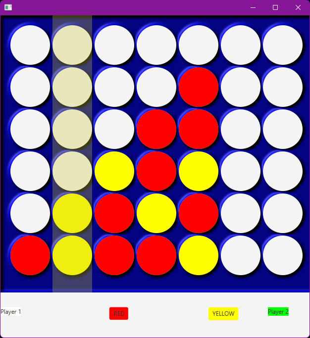

# Connect 4 Variant

A Java desktop implementation of a custom Connect 4 variant that introduces a unique strategic twist: players are not permanently assigned a counter colour and can choose from the available colours throughout the game.

This project was developed to explore alternative board game mechanics while building experience with object-oriented programming, event-driven development, GUI design, and game state management in Java.

---

## Screenshot



*Example gameplay showing column highlighting, colour selection, active player highlighting, and the custom shared-colour gameplay system.*

---
## Download

A playable Java build is available from the **Releases** section of this repository.

### Requirements

- Java Runtime Environment (JRE) 8 or newer

### Running the Game

After downloading the latest release:

```bash
java -jar Connect4++.jar
```

Alternatively, on most systems the `.jar` file can be launched by double-clicking it.

---
## Features

- Custom Connect 4 gameplay variant
- Shared colour selection system
- Editable player names
- Active player turn indicator
- Column hover highlighting
- Mouse-driven gameplay
- Automatic win detection
- End-game replay prompt
- Java-based graphical user interface

---

## Technologies Used

- Java
- Java Swing / AWT
- Object-Oriented Programming (OOP)

---

## Installation

### Prerequisites

- Java JDK 8 or newer
- A Java IDE such as:
  - IntelliJ IDEA
  - Eclipse
  - Visual Studio Code

### Clone the Repository

```bash
git clone https://github.com/devilmarster/Connect-4-.git
```

### Run the Project

1. Open the project in your preferred IDE.
2. Build the project.
3. Run the main application class.
4. The game window should launch automatically.

---

## How to Play

### Objective

The goal is to connect four counters in a row before your opponent.

Winning connections can be:

- Horizontally
- Vertically
- Diagonally

---

### Editing Player Names

Players can customise their names at any time before or during a game.

- Double-click a player name.
- Enter the new name.
- Press Enter to confirm.

---

### Selecting a Colour

Unlike traditional Connect 4, colours are **not assigned to individual players**.

Both players may choose from the available colours before placing a counter.

- Click a colour button located between the player names.
- The selected colour becomes the active colour for your next move.
- If a different colour is not selected, the previously used colour remains active.

This mechanic creates additional strategic possibilities compared to traditional Connect 4.

---

### Taking a Turn

- The current player's name is highlighted in **green**.
- Move the mouse over the board.
- The highlighted column shows where the counter will be dropped.
- Click the highlighted column to place your counter.

---

### Winning the Game

When a player creates four connected counters:

1. A popup window announces the winner.
2. The player is asked whether they would like to play another game.
3. Selecting **Yes** resets the board and starts a new match.
4. Selecting **No** closes the application.

---

## The Custom Game Variant

Traditional Connect 4 assigns one colour to each player for the entire match.

This project explores an alternative ruleset where colours belong to neither player. Instead, players select from the available colours throughout the game.

This changes how players approach both attacking and defending because colour choice becomes an additional strategic decision on every turn.

---

## Project Structure

```text
Connect-4-/
│
├── Disc.java          # Counter and piece logic
├── Game.java          # Main game logic
├── GameAttempt.java   # Experimental implementation
├── GameBackup.java    # Backup version
├── LongValue.java     # Utility/value class
├── Sprite.java        # Sprite rendering
├── Window.java        # Window and GUI management
├── img/               # Image assets
└── META-INF/          # Project metadata
```

---

## Skills Demonstrated

This project demonstrates knowledge of:

- Object-Oriented Programming
- Java GUI Development
- Event Handling
- Game State Management
- Win Condition Detection
- User Interface Design
- Mouse Interaction Systems
- Software Testing and Debugging

---

## Future Improvements

Potential future enhancements include:

- Single-player mode with AI opponents
- Improved animations and visual effects
- Main menu system
- Sound effects and music
- Adjustable board sizes
- Additional gameplay modes
- Save and load functionality
- Match statistics tracking

---

## Why I Made This

I wanted to experiment with how changing a single core rule in an established game could affect strategy and player decision-making.

The project also provided an opportunity to develop a complete desktop application from start to finish, including user interaction, graphical rendering, game logic, and replay functionality.

---

## Author

**Greg**

GitHub: https://github.com/devilmarster

---

## Licence

This project is provided for educational, learning, and portfolio purposes.
